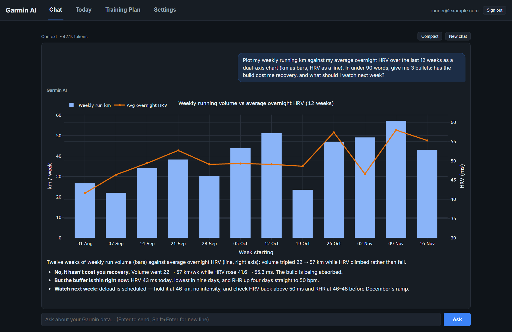
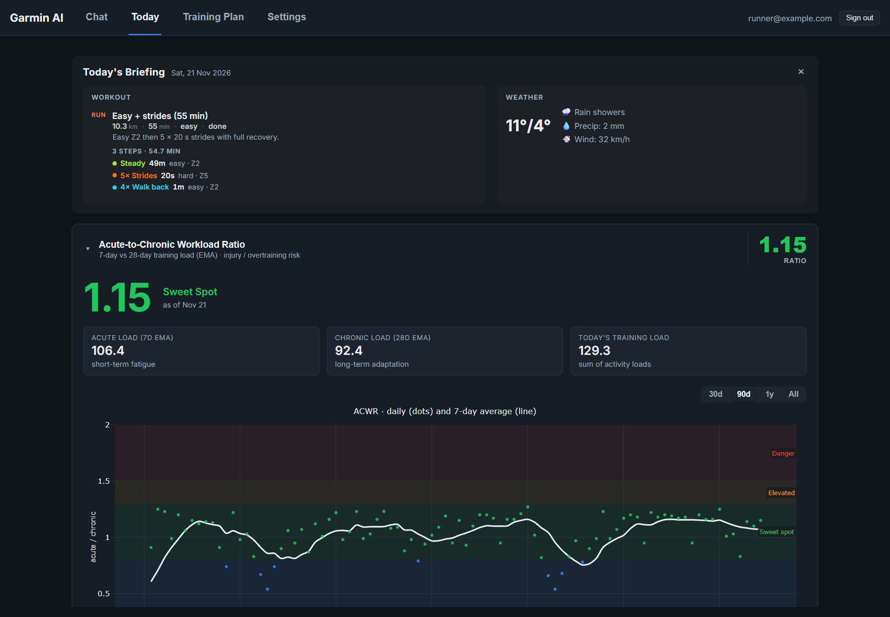
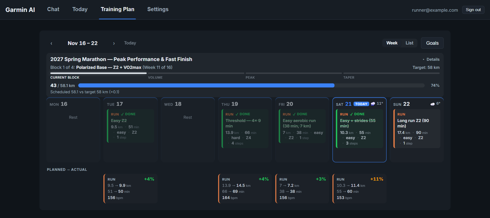
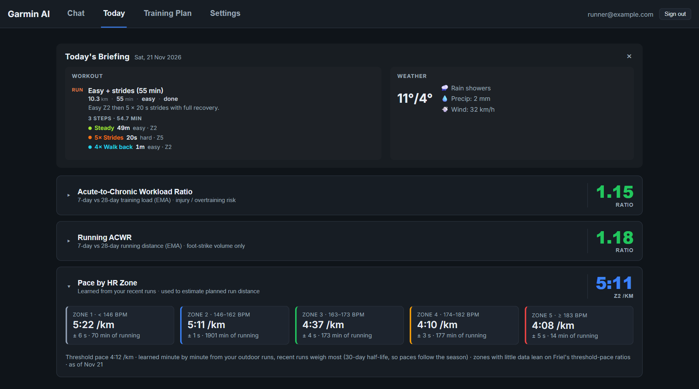

# Garmin Health-Data Agent

> Ask questions about your Garmin data in plain English, such as sleep, HRV,
> resting HR, training load or running form, and get answers backed by your own
> numbers, with charts, weather context and a training plan that both you and
> the AI can edit.

This is a self-hosted, multi-user app. It syncs Garmin Connect into Postgres and
puts a **read-only AI agent** on top of that data. The dashboard and the agent
read the same derived metrics, so a chart on screen and an answer in chat always
agree.



## Highlights

- **An agent that actually analyses your data.** It writes its own read-only SQL
  across days, activities and lap splits, then reasons over what comes back.
  That covers lagged correlations ("does last night's HRV predict today's
  pace?"), root-causing a bad session from sleep, prior load and weather, and
  spotting form breakdown under fatigue. Charts are drawn inline, right where
  the answer refers to them.
- **Training load you can trust.** ACWR, a running-only ACWR (so cycling can't
  mask a running spike) and a pace-normalised cadence-drift score are computed
  once per sync and shared by the UI and the agent.
- **Paces learned from your own runs.** Your running pace in each heart-rate
  zone is estimated minute by minute from recent outdoor runs, relative to your
  lactate-threshold pace, so it follows your fitness and the season. Planned
  runs use it to estimate distance.
- **A training plan you share with the AI.** One goal, a minutes target for
  each week of its season, and dated workouts built from structured steps.
  You can drag workouts between days, see the forecast on the calendar, compare
  planned with actual, or ask the agent to reshape the week. One undo reverts
  the last destructive edit.
- **Multi-user and isolated by design.** Every row carries a `user_id` and is
  protected by Postgres Row-Level Security. Garmin credentials are AES-GCM
  encrypted, and the agent connects through a SELECT-only role.
- **Gentle on Garmin.** Background sync runs on a bounded worker pool with
  per-account exponential backoff and ban detection. MFA is handled as a
  separate code step at signup.

<table>
  <tr>
    <td></td>
    <td></td>
  </tr>
  <tr>
    <td align="center"><b>Today</b>: briefing and ACWR</td>
    <td align="center"><b>Training Plan</b>: the week, planned → actual</td>
  </tr>
</table>

## How it works

```
Garmin Connect ─▶ sync worker ─▶ raw JSON (metrics, activities)   ◀── source of truth
                                      │
                                      ▼
                                   parser ─▶ typed tables ─▶ derived_metrics (ACWR, run ACWR,
                                                   │          drift, pace per HR zone)
                                                   │                 │
   browser (JS) ─▶ FastAPI + JWT ─▶ agent (garmin_readonly role) ◀───┘
                                     every table RLS-scoped by user_id
```

1. **Sync.** The worker pulls daily metrics, activities (including per-second
   detail and lap splits), profile data and an Open-Meteo forecast for each
   account. "Today" is the user's own day, taken from the UTC offset in their
   data, not the server's clock. Activities in the recent window are compared
   with Garmin's list on every sync, so edits are picked up and deletions
   removed. Profile snapshots (zones, race predictions, gear, devices) refresh
   once per day.
2. **Store raw, then parse.** Raw JSON is kept as the source of truth, and
   `parser.py` projects it into typed tables in one transaction. `daily_metrics`
   grows new columns as new fields appear.
3. **Derive.** `derived.py` rebuilds `derived_metrics` wholesale after every
   sync.
4. **Serve.** FastAPI serves the single-page UI and a JSON API. `/ask` streams
   the agent's answer over SSE.

## Quick start

You need **Python 3.14+**, [`uv`](https://docs.astral.sh/uv/) and Docker.

```sh
git clone https://github.com/adamzelina1/garmin-agent-web.git
cd garmin-agent-web
uv sync
cp .env.example .env      # then fill in the secrets (see Configuration)
docker compose up -d --build
```

This starts Postgres (`garmin-db`) and the app (`garmin-server`) on
<http://127.0.0.1:8000>. On a fresh volume, `docker/initdb/01-roles.sh` creates
the non-superuser `garmin_app` and `garmin_readonly` roles.

To run the server from source against the containerised database instead:

```sh
uv run garmin-server --port 8000
```

If you point the app at an existing database, bootstrap the roles once as
superuser:

```sh
uv run python -c "from garmin_fetch.server.setup_db import ensure_roles; import os
ensure_roles(os.environ['GARMIN_ADMIN_DB_URL'], os.environ['GARMIN_DB_URL'], os.environ['GARMIN_READONLY_DB_URL'])"
```

Then open the page and register. Signup logs into Garmin once to verify your
credentials and asks for a verification code if Garmin requires one. After
that, press **Sync now**.

## Using the app

The UI has four tabs:

| Tab | What's there |
| --- | --- |
| **Chat** | Streaming conversation with the agent, with charts drawn inline where the answer places them. The whole conversation is kept per account and resumes on reload; **Compact** replaces it with a summary (shown as a note) and **New chat** starts over. A live meter shows the context size. |
| **Today** | Daily briefing (today's workout with its steps, and the weather), then cards for ACWR, Running ACWR and Pace by HR Zone. Open a card to see the breakdown and history. |
| **Training Plan** | **Week** view: where the week sits in the season (week N of M, days to the goal), the week's minutes against its target, drag-and-drop workouts with the forecast, and a planned → actual row for completed sessions. **List** view: the next eight weeks. **Goal** edits the goal and its weekly targets. |
| **Settings** | **Sync**: **Sync now**, **Sync + full re-parse**, the auto-sync toggle, the sync start date (with **Detect from Garmin**) and re-linking the Garmin login. **Preferences**: home city, excluded data types, agent reasoning effort, training principles and the agent's long-term memory. |



### Settings that apply retroactively

Changing excluded data types or the sync start date takes effect on the next
sync. Dates before the start date are deleted. Newly excluded types lose their
raw rows, and their exclusive `daily_metrics` columns are set to NULL (shared
columns are kept). Excluded columns are also hidden from the agent.

**Detect from Garmin** finds the first day of an account's history. It anchors
on the oldest activity, gallops backwards probing daily summaries, and then
binary-searches to the exact day. A gap where the watch wasn't worn is not
mistaken for the start.

### API

Every route except `/`, register and login needs `Authorization: Bearer <token>`.

```sh
TOKEN=$(curl -s -X POST http://127.0.0.1:8000/auth/login \
  -H 'Content-Type: application/json' \
  -d '{"email":"you@example.com","password":"..."}' | python -c 'import sys,json;print(json.load(sys.stdin)["token"])')
H="Authorization: Bearer $TOKEN"

curl -s -X POST localhost:8000/sync       -H "$H"   # incremental sync
curl -s -X POST localhost:8000/sync/full  -H "$H"   # sync + full re-parse from raw
curl -s localhost:8000/acwr               -H "$H"   # ACWR series + today
curl -s localhost:8000/run-acwr           -H "$H"   # running-only ACWR
curl -s localhost:8000/zone-paces         -H "$H"   # learned pace per HR zone
curl -s "localhost:8000/activities?from_date=2026-08-01&to_date=2026-08-31" -H "$H"
curl -s "localhost:8000/weather?from_date=2026-08-24&to_date=2026-08-30"    -H "$H"
curl -s -X POST localhost:8000/ask -H "$H" -H 'Content-Type: application/json' \
  -d '{"question":"avg sleep last week?"}'
```

| Group | Routes |
| --- | --- |
| Auth & config | `POST /auth/register`, `POST /auth/register/mfa`, `POST /auth/login`, `POST /auth/garmin` (re-link the Garmin login), `GET /auth/me`, `GET`/`PUT /auth/config` |
| Sync | `POST /sync`, `POST /sync/full`, `POST /sync/detect-start`, `GET /sync/status`, `POST /cron/sync` (uses `GARMIN_CRON_TOKEN`) |
| Data | `GET /acwr`, `GET /run-acwr`, `GET /zone-paces`, `GET /activities`, `GET /weather` |
| Training | `GET`/`POST /training/workouts`, `PATCH`/`DELETE /training/workouts/{id}`, `GET`/`PATCH`/`DELETE /training/anchor`, `POST /training/undo` |
| Agent | `POST /ask` (SSE), `GET /ask/history`, `POST /ask/clear`, `POST /ask/compact`, `POST /ask/chart` |

### CLI

These single-user tools act on the account set by `GARMIN_LOCAL_USER_ID`, with
the Garmin login, start date, home location and excluded data types it has in
Settings; a CLI sync is the same sync the server runs.

```sh
uv run garmin-fetch                        # incremental sync of all types
uv run garmin-fetch --parse --full         # full re-parse of stored raw data
uv run garmin-fetch --range 2026-01-01 2026-02-01 --type sleep
uv run garmin-ask "avg sleep last week?"   # ask the agent from the terminal
uv run garmin-trace                        # inspect the agent's tool-call trace
uv run garmin-trace --failures --all-users --since 2026-11-01   # where the agent struggles with its tools
```

Syncs with an explicit `--range` or `--type` never prune data.

## The agent

The agent is built on Pydantic AI and is read-only at every layer:

1. It connects as `garmin_readonly`, a SELECT-only role with real REVOKEs.
2. RLS limits it to the signed-in user's rows. The role has no `EXECUTE` on
   `set_config`, so a query cannot change `app.user_id`; the server binds the
   user with `SET LOCAL` and refuses to start if the role could still switch.
3. A statement gate allows only `SELECT`, `WITH` and `EXPLAIN`, an
   allowed-tables list blocks raw and internal tables, and functions that run
   SQL strings or change settings are rejected.
4. Every statement runs under a 20-second `statement_timeout`.

| Tool | Purpose |
| --- | --- |
| `table_schema`, `run_sql` | Inspect one or more tables and run arbitrary read-only SQL |
| `get_day_summary`, `get_recent_activities`, `get_activity_detail` | Fast helpers for common questions, no SQL needed |
| `get_metric_trend` | Several daily metrics side by side, each with its last-7-day average against your normal level |
| `chart` | Validates a Plotly spec against the query result and returns a chart id; the answer places it with `<chart id="…"/>` and the UI renders it there |
| `weather` | Live Open-Meteo weather for a day or place the database doesn't cover, as context only (stored activity weather and the home forecast are read with SQL) |
| `memory` | Long-term notes about the user (never facts that the DB already holds) |
| `training` | Reads the season: the goal, each week's target with its place in the season, planned workouts and planned-vs-actual coverage |
| `training_apply` | One atomic, typed edit to the plan (or `undo`) |

The system prompt carries the user's own "today" and their learned zone paces.
The agent never writes health data: edits to the plan, memory and session go
through the app's own stores. To keep context small, past reasoning is dropped
from the stored session and tool outputs are trimmed before they are saved.
Some models occasionally write a tool call into their reply as text; that
markup is stripped and the model is sent back once to make the call properly.

## Derived metrics

`derived.py` computes these metrics after each sync and stores them in
`derived_metrics`:

- **ACWR** (`workload.py`): daily training load from
  `activity_summaries.training_load`. The ratio is acute load (EMA₇) over
  chronic load (EMA₂₈), banded as Detraining, Sweet Spot, Elevated or Danger.
  Rest days count as zero, so a taper shows up as a falling ratio.
- **Running ACWR** (`run_workload.py`): the same EMAs built from running
  distance only.
- **Cadence drift** (`run_cadence_drift`): a cadence z-score against your own
  cadence-vs-pace fit over the trailing 90 days. A negative score means
  overstriding or worse mechanics.
- **Pace per HR zone** (`zone_pace.py`, `zone_pace_z1`…`z5`): each zone's pace
  is modelled as a ratio to your current lactate-threshold pace. The prior is
  Joe Friel's run pace zones; the evidence is one-minute windows from recent
  outdoor runs, grouped by HR zone and weighted by recency (30-day half-life).
  Warm-ups, stops and treadmill runs are left out, and a higher zone is never
  slower than a lower one.

Planned workouts use these values too. A workout's duration is the sum of its
steps, and a run's distance is always an estimate built from each step's pace
or its HR zone's pace, re-priced on every sync while the run is still planned.

## Data model

Every data table is keyed by `(user_id, …)` and has `FORCE ROW LEVEL SECURITY`.
`users` is the only exception.

| Table | Holds |
| --- | --- |
| `users` | Email, bcrypt hash, encrypted Garmin credentials and tokens, sync status and backoff, per-account settings |
| `metrics` | Raw daily Garmin JSON by `(data_type, calendar_date)`. This is the source of truth. |
| `activities` | Raw activity summaries plus detail, weather and splits payloads |
| `sync_state` | Per-account sync bookkeeping |
| `daily_metrics` | One wide parsed row per day. Columns are created on demand. |
| `activity_summaries` | Parsed activities: duration, HR, zones, power, cadence, elevation, weather |
| `activity_detail_series` | Per-tick HR, cadence, power, speed, elevation and GPS |
| `activity_splits` | Per-lap splits |
| `hr_zones`, `power_zones` | Per-sport zone ranges (and FTP) from the device profile |
| `race_predictions` | Current 5k, 10k, half and full predictions |
| `user_profile`, `gear`, `devices` | Profile snapshots, current gear with totals, current devices |
| `derived_metrics` | `(calendar_date, metric)` rows for ACWR, run ACWR, cadence drift and zone paces. Replaced each sync. |
| `weather_forecast` | Stored daily Open-Meteo forecast, refreshed each sync |
| `training_goal` | The account's one goal: sport, season start date, target date, distance and target time |
| `training_week` | Per-week targets (minutes, deload flag) keyed by Monday |
| `training_workout` | Dated workouts with a headline HR zone, structured steps (each with an HR zone or pace) and a status (`planned`, `completed`, `partial` or `skipped`) |
| `user_state` | Agent memory, chat history, tool trace and the season undo snapshot |

## Configuration

Server-wide settings live in `.env` (see [`.env.example`](.env.example)).
Per-account settings live in the `users` table and are edited from the UI.

| Variable | Meaning |
| --- | --- |
| `GARMIN_DB_URL`, `GARMIN_READONLY_DB_URL`, `GARMIN_ADMIN_DB_URL` | App (writer), agent (read-only) and superuser DSNs. The superuser DSN is used only for role bootstrap. |
| `GARMIN_ENC_KEY` | Base64 of a 32-byte AES-GCM key |
| `GARMIN_JWT_SECRET`, `GARMIN_JWT_TTL_HOURS` | JWT signing secret and token lifetime |
| `GARMIN_CRON_TOKEN` | Bearer token for `POST /cron/sync` |
| `GARMIN_ALLOW_SIGNUP` | `0` closes `POST /auth/register` (on by default) |
| `GARMIN_SYNC_INTERVAL_MIN`, `GARMIN_SYNC_MAX_WORKERS` | Background worker tuning |
| `GARMIN_FETCH_SLEEP_SEC` | Delay between Garmin API calls (`2` is a good value for backfills) |
| `GARMIN_AUTO_SYNC` | Default for the per-account auto-sync toggle (off unless set) |
| `GARMIN_ACTIVITY_FREEZE_DAYS` | Trailing days re-scanned for late activity uploads |
| `GARMIN_LOCAL_USER_ID` | Account the CLI tools act on, with its stored Garmin login and settings |
| `GARMIN_START_DATE` | Default first day to back-fill; each account can set its own |
| `LLM_PROVIDER`, `LLM_API_KEY`, `LLM_BASE_URL`, `LLM_MODEL` | Server-wide LLM. `openai` covers any OpenAI-compatible endpoint, including Ollama; `gemini` is also supported. |
| `LLM_REASONING_EFFORT` | Default reasoning effort (`low`, `medium` or `high`), which each account can override |

To generate an encryption key:

```sh
uv run python -c "import secrets,base64;print(base64.b64encode(secrets.token_bytes(32)).decode())"
```

## Security

- **RLS is the boundary.** The runtime roles are not superusers, and every data
  table enforces a `user_isolation` policy on `current_setting('app.user_id')`.
  As a side effect, a raw `psql` session sees zero rows until it runs
  `SELECT set_config('app.user_id', '<id>', false)`.
- **Secrets at rest.** Garmin credentials and OAuth tokens are AES-GCM
  encrypted. Tokens are re-encrypted after each refresh and never logged.
- **Defense in depth for the agent.** The read-only role is the real
  enforcement. The statement gate and the allowed-tables list are a second
  layer.
- **Rate limits.** Failed syncs (a rejected Garmin login included) back off
  30 min × 2ⁿ, capped at 8 h. A detected ban jumps straight to 8 h, and a
  rate-limit error mid-sync ends that sync instead of being skipped per day.
  Sign-in, sign-up and Garmin re-link attempts are capped in memory per caller;
  sign-ups are also capped server-wide because each one logs in to Garmin.
- Run the server behind TLS for anything beyond localhost, and change the
  default database passwords in `docker-compose.yml`. Postgres is published on
  `127.0.0.1` only.

## Project layout

```
src/garmin_fetch/
  fetcher.py        Garmin Connect sync (+ weather forecast refresh)
  parser.py         raw JSON → typed tables
  datatypes.py      data-type registry
  db.py             schema, RLS, per-user Database
  derived.py        rebuilds derived_metrics
  workload.py       ACWR
  run_workload.py   running ACWR + cadence drift
  zone_pace.py      learned pace per HR zone
  ask.py            the read-only agent and its tools
  tool_args.py      lenient argument types for the agent's tools
  chat_format.py    answer/session shaping (charts, leaked tool calls)
  trace.py          per-turn tool-call tracing + failure summary
  config.py         .env loading
  server/
    app.py          FastAPI routes
    auth.py         users, bcrypt, JWT, Garmin-verified signup/re-link + MFA
    ratelimit.py    in-memory attempt limits for the auth endpoints
    crypto.py       AES-GCM
    sync_worker.py  worker pool, APScheduler cron, backoff
    geocode.py      home city → lat/lon
    setup_db.py     role bootstrap
    state/          agent memory/session/trace, training season store + agent training tools
    static/         index.html (the whole frontend)
docker/initdb/      role bootstrap for a fresh Postgres volume
```

## Tech stack

Python 3.14 · uv · PostgreSQL 17 · FastAPI · APScheduler · Pydantic AI · Plotly ·
Open-Meteo · garminconnect · PyJWT · bcrypt · cryptography
